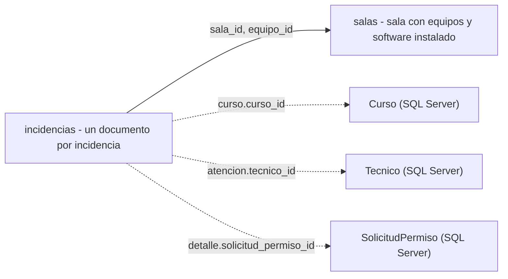

# Incidencias y salas (Unidad 2, MongoDB)

Este documento justifica cómo se modelan en MongoDB las **incidencias** y se implementan múltiples RNF

Archivos relacionados: `esquema/01_colecciones_validacion.js`, `esquema/02_indices.js`, `esquema/03_pruebas_validacion.js`, `migracion/migrar_salas.js`.


## 1. Por qué existe este modelo documental

Una falla de hardware habla de componentes y síntomas, un error de software trae el programa y el mensaje de error; un problema de permisos.

En el modelo relacional esto obliga a elegir entre una tabla ancha llena de columnas `NULL` o una tabla por tipo con joins. En un documento, en cambio, cada incidencia es una unidad completa y autocontenida, la parte común (quién, cuándo, dónde, qué clase, estado) tiene siempre la misma forma, y la parte que varía vive en un único subdocumento, `detalle`.

Además, la incidencia se consulta casi siempre entera.

## 2. Vista general



- Línea continua: referencia dentro de MongoDB (permite `$lookup`).
- Línea punteada: referencia hacia SQL Server por llave de negocio

## 3. El documento de incidencia

### 3.1 Estructura (ejemplo completo, incidencia de permisos)

```js
// ejemplo: incidencia de permisos
{
  tipo: "permisos",                       
  descripcion: "No se puede habilitar TCP en SQL Server durante la clase",
  severidad: "alta",
  estado: "en_atencion",
  impacto_clase: "total",
  fecha_reporte: ISODate("2026-10-05T14:30:00Z"),

  // referenciados 
  sala_id: 1,                             // salas.sala_id
  equipo_id: 1,                           // salas.equipos.equipo_id (opcional)

  // embebidos 
  curso: { curso_id: 1, codigo: "ISLPE04", nombre: "BASE DE DATOS AVANZADA (LINEA PROF. I)" },
  reportado_por: { nombre: "Pedro Alvarez", rol: "docente" },

  detalle: {                              // estructura variable según 'tipo'
    software: { software_id: 1, nombre: "SQL Server 2022", version: "16.0" },
    accion_bloqueada: "habilitar conexiones TCP",
    nivel_actual: "restringido",
    nivel_requerido: "administrador",
    solicitud_permiso_id: 1               // = SolicitudPermiso (SQL Server)
  },

  atencion: {                             // plazo y responsable
    fecha_limite: ISODate("2026-10-12T13:00:00Z"),   // siguiente sesión del curso en esa sala
    tecnico_id: 1,
    tecnico_nombre: "Carlos Pérez"
  },

  historial: [                            // Un elemento por cambio de estado
    { estado: "abierta",     fecha: ISODate("2026-10-05T14:30:00Z"), por: "Pedro Alvarez", nota: "Reportada durante la clase" },
    { estado: "en_atencion", fecha: ISODate("2026-10-06T09:15:00Z"), por: "Carlos Pérez" }
  ]
}
```

### 3.2 Campos

| Campo | Tipo | Obligatorio | Descripción |

| `tipo` | texto (`hardware`, `software`, `permisos`) | sí | Decide la forma de `detalle`. |
| `descripcion` | texto (10–500) | sí | Qué ocurrió, en palabras de quien reporta. |
| `severidad` | `baja`, `media`, `alta`, `critica` | sí | Prioriza la atención y agrupa reportes. |
| `estado` | `abierta`, `en_atencion`, `cerrada` | sí | Estado de atención actual. |
| `impacto_clase` | `ninguno`, `parcial`, `total` | no | Cuánto afectó el desarrollo de la clase. |
| `fecha_reporte` | fecha | sí | Cuándo se reportó. |
| `sala_id` | número | sí | Sala donde ocurrió (referencia a `salas`). |
| `equipo_id` | número | no | Equipo afectado y ausente cuando la incidencia es de toda la sala. |
| `curso` | subdocumento | sí | Clase afectadam `curso_id` (obligatorio), `codigo`, `nombre`. |
| `reportado_por` | subdocumento | sí | `nombre` y `rol` (`estudiante` o `docente`). |
| `detalle` | subdocumento | sí | Campos propios del tipo. |
| `atencion` | subdocumento | no | `fecha_limite`, `tecnico_id`, `tecnico_nombre`, `fecha_cierre`, `solucion`. |
| `historial` | arreglo (mayor igual a 1) | sí | Cambios de estado con fecha, autor y nota. |

Es obligatorio lo que todas las consultas y reportes necesitan (tipo, severidad, estado, fecha, sala, clase, reportante, historial). Es opcional lo que depende del contexto (un equipo concreto, el plazo de atención, el impacto).

## 4. Qué va embebido y qué referenciado

Tres preguntas deciden cada caso:

1. ¿Se lee siempre junto con la incidencia?
2. ¿Su cantidad está acotada?
3. ¿Su ciclo de vida depende de la incidencia (nace y muere con ella)?

Si las tres son "sí", se embebe. Si el dato vive por sí mismo, lo comparten muchas incidencias o crece sin límite, se referencia.

| Elemento | Decisión | Justificación |
|---|---|---|
| `detalle` | Embebido | Solo tiene sentido dentro de su incidencia, es la parte variable del documento. |
| `atencion` | Embebido | Relación 1 a 1, nace con la incidencia y se lee con ella. |
| `historial` | Embebido (arreglo) | pocos cambios de estado por incidencia, siempre se muestra junto a ella y nunca se consulta suelto.|
| `reportado_por` | Embebido (copia) | En el sistema no existe una colección ni una tabla de usuarios, los docentes y estudiantes no se modelan. El dato es una foto de quién reportó. |
| `curso` | Referencia + copia mínima | `curso_id` apunta a `Curso` (SQL Server, fuente de verdad), se copian `codigo` y `nombre` porque son lo que siempre se muestra, evitando consultar otro motor por cada incidencia listada. Si el curso cambia de nombre, las incidencias históricas conservan el de su momento. |
| `atencion.tecnico_id` / `tecnico_nombre` | Referencia + copia mínima | Mismo patrón, hacia `Tecnico`. |
| `detalle.software` | Referencia + copia mínima | `software_id`, `nombre` y `version` del catálogo `Software`. |
| `detalle.solicitud_permiso_id` | Referencia | Enlaza con la solicitud formal de permiso registrada en SQL Server. |
| **`sala_id`** | Referenciado a `salas` | Una sala acumula incidencias sin límite (relación 1 a N no acotada). Embeber la sala en cada incidencia duplicaría sus datos y los dejaría desactualizados, embeber las incidencias dentro de la sala produciría un arreglo que crece sin tope. Referenciar permite además cruzar ambas colecciones con `$lookup`. |
| `equipo_id` | Referenciado | El equipo vive embebido en `salas.equipos`; la incidencia lo referencia por su llave de negocio. |

## 5. Estructura variable: el campo 'detalle'

Todas las incidencias viven en una sola colección y el campo `tipo` indica qué forma tiene `detalle`.

| `tipo` | Campos obligatorios de `detalle` | Campos habituales opcionales |
|---|---|---|
| `hardware` | `componente`, `sintoma` | `enciende` (booleano) |
| `software` | `software` (`software_id`, `nombre`, `version`), `mensaje_error` | `reproducible` (booleano) |
| `permisos` | `accion_bloqueada`, `nivel_requerido` | `software`, `nivel_actual`, `solicitud_permiso_id` |

Los campos adicionales dentro de `detalle` están permitidos y no requieren migración (por ejemplo, `temperatura_c` o `fotos` en hardware): la estructura evoluciona sin alterar la colección.

```js
// ejemplo: incidencia de hardware, con un campo libre
{
  tipo: "hardware",
  descripcion: "El monitor no muestra imagen al encender el equipo",
  severidad: "media",
  estado: "abierta",
  impacto_clase: "parcial",
  fecha_reporte: ISODate("2026-10-06T15:20:00Z"),
  sala_id: 2,
  equipo_id: 3,
  curso: { curso_id: 2, codigo: "ISLPE05", nombre: "INTELIGENCIA ARTIFICIAL (LINEA PROF. II)" },
  reportado_por: { nombre: "Camila Torres", rol: "estudiante" },
  detalle: { componente: "monitor", sintoma: "sin senal de video", enciende: true, cable_probado: true },
  atencion: { fecha_limite: ISODate("2026-10-13T15:00:00Z") },
  historial: [{ estado: "abierta", fecha: ISODate("2026-10-06T15:20:00Z"), por: "Camila Torres" }]
}
```

```js
// ejemplo:incidencia de software, ya cerrada
{
  tipo: "software",
  descripcion: "Python no encuentra la libreria pandas en los equipos de la sala",
  severidad: "baja",
  estado: "cerrada",
  impacto_clase: "ninguno",
  fecha_reporte: ISODate("2026-10-07T19:40:00Z"),
  sala_id: 3,
  equipo_id: 5,
  curso: { curso_id: 3, codigo: "ISSAE05", nombre: "SEGURIDAD INFORMATICA (SEM. ACTUALIZACION II)" },
  reportado_por: { nombre: "Laura Gomez", rol: "docente" },
  detalle: {
    software: { software_id: 3, nombre: "Python", version: "3.12" },
    mensaje_error: "ModuleNotFoundError: No module named 'pandas'",
    reproducible: true
  },
  atencion: {
    fecha_limite: ISODate("2026-10-14T19:00:00Z"),
    tecnico_id: 2,
    tecnico_nombre: "Ana María Gómez",
    fecha_cierre: ISODate("2026-10-08T15:00:00Z"),
    solucion: "Se instalo pandas con pip en todos los equipos de la sala"
  },
  historial: [
    { estado: "abierta",     fecha: ISODate("2026-10-07T19:40:00Z"), por: "Laura Gomez" },
    { estado: "en_atencion", fecha: ISODate("2026-10-08T13:00:00Z"), por: "Ana María Gómez" },
    { estado: "cerrada",     fecha: ISODate("2026-10-08T15:00:00Z"), por: "Ana María Gómez", nota: "Verificado en la sala" }
  ]
}
```

### Alternativas descartadas

| Alternativa | Por qué no |
|---|---|
| Una colección por tipo (`incidencias_hardware`, …) | Los reportes cruzan tipos (incidencias por sala, por curso, por equipo), habría que unir colecciones y duplicar índices y validadores. |
| Un solo documento con todos los campos posibles | Reproduce la "tabla ancha con NULL" del modelo relacional. |
| Pares clave–valor genéricos (`[{campo, valor}]`) | Se pierde la validación por tipo y los índices sobre campos concretos. |
| Embeber las incidencias dentro de cada sala | Arreglo sin tope, documento que crece indefinidamente. |

## 6. La colección `salas` (migrada desde SQL Server)

`salas` no nace en MongoDB, se migra desde cuatro tablas relacionales y se transforma al modelo documental.

| SQL Server | MongoDB | Decisión |
|---|---|---|
| `Sala` | documento raíz (`sala_id`, `nombre`, `ubicacion`, `capacidad`, `estado`) | Una fila = un documento. `sala_id` se conserva como llave de negocio compartida. |
| `Equipo` (FK `sala_id`) | arreglo embebido `equipos` | Relación 1 a N acotada (limitada por la capacidad de la sala), los equipos no existen fuera de su sala y la vista de salas los muestra siempre juntos. |
| `EquipoSoftware` + `Software` | arreglo embebido `software_instalado` dentro de cada equipo | La tabla puente desaparece ya que su atributo (`nivel_permisos`) pasa a vivir dentro de cada elemento. Del catálogo solo se copian `software_id`, `nombre` y `version`; el catálogo completo no se embebe porque existe por sí mismo y lo comparten muchos equipos. |
| columnas `NULL` | campo **ausente** | En un documento no se guarda un `NULL`: si no hay dato, el campo no existe. |

```js
// ejemplo:salas - Laboratorio 401 
{
  sala_id: 3,
  nombre: "Laboratorio 401",
  ubicacion: "Bloque 2 - Piso 4",
  capacidad: 20,
  estado: "disponible",
  equipos: [
    {
      equipo_id: 5,
      especificaciones: "Core i7, 16GB RAM, 512GB SSD",
      estado: "disponible",
      software_instalado: [
        { software_id: 3, nombre: "Python",          version: "3.12", nivel_permisos: "estandar" },
        { software_id: 4, nombre: "MongoDB Compass", version: "1.42", nivel_permisos: "estandar" },
        { software_id: 5, nombre: "Docker Desktop",  version: "4.30", nivel_permisos: "administrador" }
      ]
    },
    {
      equipo_id: 6,
      especificaciones: "Core i7, 16GB RAM, 512GB SSD",
      estado: "disponible",
      software_instalado: [
        { software_id: 3, nombre: "Python",          version: "3.12", nivel_permisos: "estandar" },
        { software_id: 4, nombre: "MongoDB Compass", version: "1.42", nivel_permisos: "estandar" }
      ]
    }
  ],
  origen: "sqlserver",
  migrado_en: ISODate("2026-10-29T00:00:00Z")
}
```

SQL Server sigue siendo la fuente de verdad del inventario y de su estado (por ejemplo, el trigger que pone un equipo "en mantenimiento"). La colección `salas` es una copia de lectura para el módulo de incidencias y se refresca volviendo a ejecutar la migración, (hace upsert por `sala_id`, nunca duplica). El estado de un equipo en MongoDB puede quedar desactualizado hasta la siguiente migración.

`_id` y `sala_id`. `_id` se deja como `ObjectId` automático y `sala_id` tiene un índice único, así el documento conserva la identidad original de SQL Server sin sobrecargar el significado de `_id`.

## 7. Relación con el módulo relacional y límites del modelo

- La tabla `Incidencia` de SQL Server (`schema/09_incidencia.sql`) es una proyección mínima (equipo, descripción, estado abierta/cerrada) que existe para que `sp_registrar_mantenimiento` pueda cerrar incidencias dentro de una transacción con `SAVE TRANSACTION`. El vínculo natural entre ambos es `equipo_id`.
- Las llaves compartidas usan el mismo nombre que en SQL Server: `sala_id`, `equipo_id`, `curso_id`, `tecnico_id`, `software_id`, `solicitud_permiso_id`.

## 8. Validación de esquema

Definida en `esquema/01_colecciones_validacion.js` con `$jsonSchema`, nivel `strict` (se valida en inserciones y actualizaciones) y acción `error` (el documento inválido se rechaza).

- Se exige el núcleo común de toda incidencia, los dominios cerrados (`tipo`, `severidad`, `estado`, `rol`, niveles de permiso), los tipos de dato (fechas como fecha, ids como número) y un `historial` con al menos un elemento.
- Por tipo, con `oneOf`, cada rama fija el valor de `tipo` y exige los campos mínimos de su `detalle` (una incidencia `software` con detalle de hardware se rechaza).
- Se deja libre todo lo demás, campos nuevos dentro de `detalle` o de la incidencia no se rechazan.

`esquema/03_pruebas_validacion.js` demuestra el comportamiento con 14 casos (4 documentos que se aceptan y 10 que se rechazan, cada uno por un motivo distinto) sobre una colección temporal, sin tocar los datos reales.

## 9. Índices

Definidos en `esquema/02_indices.js`. Cada índice responde a una consulta concreta del proyecto:

| Colección | Índice | Consulta o regla que atiende |
|---|---|---|
| `salas` | `{ sala_id: 1 }` único | Evita duplicados al migrar y es el campo destino del `$lookup` desde `incidencias`. |
| `salas` | `{ "equipos.equipo_id": 1 }` (multikey) | Hallar la sala a la que pertenece un equipo. |
| `incidencias` | `{ sala_id: 1, fecha_reporte: -1 }` | Incidencias de una sala, las más recientes primero; reportes de uso por sala. |
| `incidencias` | `{ equipo_id: 1, fecha_reporte: -1 }` | Incidencias repetidas en un mismo equipo dentro de un periodo corto. |
| `incidencias` | `{ "curso.curso_id": 1, fecha_reporte: -1 }` | Materias más afectadas. |
| `incidencias` | `{ estado: 1, "atencion.fecha_limite": 1 }` | Incidencias abiertas ordenadas por su plazo. |

Los índices compuestos ponen primero el campo de igualdad y después el de orden, de modo que la misma estructura sirve para filtrar y ordenar sin ordenar en memoria.

Sobre `salas.estado` (la colección es pequeña) y sobre `tipo` o `severidad` solos (pocos valores distintos, poca selectividad). Cada índice adicional encarece las escrituras, así que se crean solo los que sirven a una consulta real.

## 10. Valores de referencia para los datos de prueba

Para que los datos de prueba sean coherentes con SQL Server y funcionen en el `$lookup`, deben usar identificadores que existan.

| Dato | Valores válidos |
|---|---|
| `sala_id` | 1 = Sala 301, 2 = Sala 302, 3 = Laboratorio 401 |
| `equipo_id` = sala | 1 y 2 = sala 1; 3 y 4 = sala 2; 5 y 6 = sala 3 (el `equipo_id` debe pertenecer a la `sala_id` indicada) |
| `curso` | 1 = ISLPE04 *BASE DE DATOS AVANZADA (LINEA PROF. I)*, 2 = ISLPE05 *INTELIGENCIA ARTIFICIAL (LINEA PROF. II)*, 3 = ISSAE05 *SEGURIDAD INFORMATICA (SEM. ACTUALIZACION II)*, 4 = IS066 *ARQUITECTURA DE SISTEMAS* |
| `tecnico_id` | 1 = Carlos Pérez, 2 = Ana María Gómez |
| `software_id` | 1 = SQL Server 2022 (16.0), 2 = Visual Studio (2022), 3 = Python (3.12), 4 = MongoDB Compass (1.42), 5 = Docker Desktop (4.30) |

Recomendaciones: el último elemento de `historial` debe coincidir con `estado`. `atencion.fecha_cierre` y `solucion` solo aparecen en incidencias `cerrada`; y las fechas deben ser fechas (`ISODate(...)`), no texto.

## 11. Cómo ejecutarlo

Ver `mongodb/README.md` (orden de ejecución, variables de entorno y solución de problemas).
